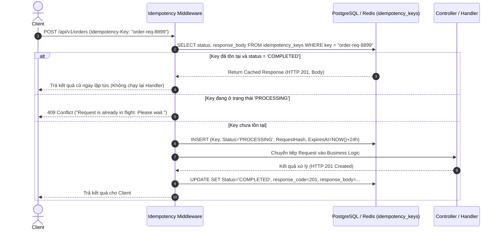

# API Specification & Design Standards

## 1. RESTful Conventions & Versioning
- **Base URI:** `/api/v1/{module}/{resource}`
- **Versioning Strategy:** URI Versioning (`/v1/`, `/v2/`). Không dùng header versioning để đơn giản hóa việc cache ở CDN và API Gateway.
- **HTTP Methods:**
  - `GET`: Truy vấn dữ liệu (Safe & Idempotent).
  - `POST`: Tạo mới tài nguyên hoặc kích hoạt command phức tạp.
  - `PUT`: Cập nhật toàn bộ tài nguyên (Idempotent).
  - `PATCH`: Cập nhật một phần tài nguyên.
  - `DELETE`: Xóa tài nguyên (Idempotent).

---

## 2. Standard Request & Response Headers

### Request Headers
- `Authorization: Bearer <JWT_ACCESS_TOKEN>`
- `X-Correlation-Id: <UUID>`: Client hoặc Gateway sinh ra để theo dõi toàn bộ hành trình request.
- `Idempotency-Key: <UUID_OR_STRING>`: **Bắt buộc** với các endpoints làm thay đổi tài sản/tiền tệ:
  - `POST /api/v1/orders`
  - `POST /api/v1/payments`
  - `POST /api/v1/inventory/reservations`
  - `POST /api/v1/orders/{id}/cancel`

### Response Headers
- `X-Correlation-Id`: Trả lại correlation ID để tra cứu log.
- `X-Trace-Id`: Trace ID theo chuẩn W3C TraceContext.
- `X-RateLimit-Limit`, `X-RateLimit-Remaining`, `X-RateLimit-Reset`: Thông tin giới hạn tần suất.

---

## 3. Standardized Error Response (RFC 7807 Problem Details)

Tất cả các lỗi (4xx, 5xx) đều tuân theo chuẩn **RFC 7807**:

```json
{
  "type": "https://api.ecommerce.com/errors/out-of-stock",
  "title": "Inventory Unavailable",
  "status": 409,
  "detail": "SKU 'IPHONE15-PRO-256-BLUE' does not have enough stock available (Requested: 2, Available: 1).",
  "instance": "/api/v1/orders",
  "code": "OUT_OF_STOCK",
  "correlationId": "4a7b9c1d-8f2e-4b6a-9c3d-1e5f7a9b3c5e",
  "timestamp": "2026-10-01T07:45:00Z",
  "errors": [
    {
      "field": "items[0].skuId",
      "message": "Insufficient stock"
    }
  ]
}
```

---

## 4. Idempotency Middleware Workflow



---

## 5. Pagination Standards: Cursor vs Offset

1. **Cursor (Keyset) Pagination (Bắt buộc cho bảng lớn: Orders, Audit Logs, Reviews):**
   - URL: `GET /api/v1/orders?cursor=2026-10-01T07:00:00Z&limit=20`
   - SQL: `WHERE created_at < @cursor ORDER BY created_at DESC LIMIT 20`
   - *Ưu điểm:* Hiệu năng luôn là O(1) bất kể dữ liệu ở trang thứ 1 hay trang thứ 1,000,000; không bị hiện tượng nhảy trang khi có bản ghi mới chèn vào.
2. **Offset Pagination (Chỉ dùng cho bảng nhỏ ít biến động: Categories, Roles, Admin lists):**
   - URL: `GET /api/v1/categories?page=1&pageSize=50`
   - SQL: `OFFSET 0 LIMIT 50`
