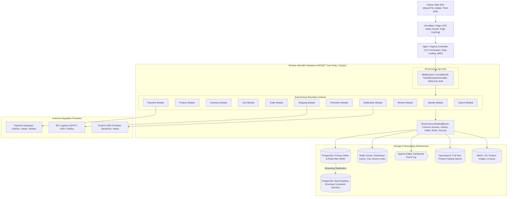
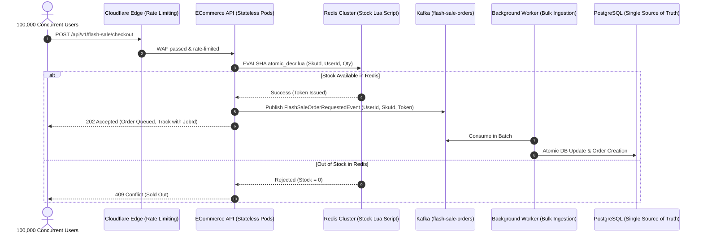
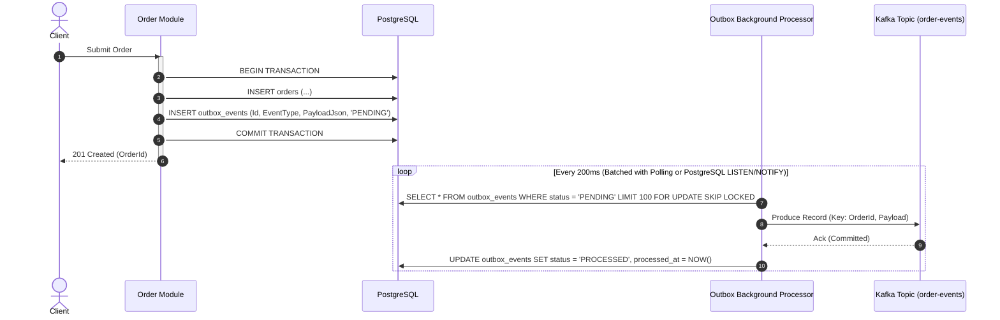

# Architecture Blueprint: Production-Ready E-Commerce Platform

## 1. Executive Summary & Vision

Hệ thống được thiết kế theo mô hình **Modular Monolith** chuẩn Domain-Driven Design (DDD) và Clean Architecture, tối ưu hóa cho **High Concurrency**, **Fault Tolerance**, **Data Consistency** và **Horizontal Scalability**. Kiến trúc duy trì ranh giới độc lập tuyệt đối giữa các Bounded Context để có thể chia tách thành Microservices độc lập trong tương lai mà không cần refactor logic nghiệp vụ cốt lõi.

### Core Architectural Pillars
- **Zero-Dependency Module Boundaries:** Các module không tham chiếu trực tiếp DbContext hay implementation của nhau. Giao tiếp nội bộ đồng bộ chỉ thông qua In-Memory MediatR Queries/Commands (Contract Interfaces), giao tiếp bất đồng bộ qua **Kafka Event Bus**.
- **Transactional Outbox & Dual-Write Protection:** Mọi thay đổi state và domain event đều nằm trong cùng một database transaction. Background worker đảm bảo **At-least-once delivery** lên Apache Kafka.
- **Strict Concurrency Control:** Cơ chế inventory reservation sử dụng Atomic Conditional Update kết hợp với State Machine nghiêm ngặt và TTL Expiration, triệt tiêu hoàn toàn rủi ro oversell và race conditions.
- **Idempotency by Design:** Tất cả mutating endpoints quan trọng (`POST /orders`, `POST /payments`, `POST /inventory/reservations`, webhooks) đều bắt buộc Idempotency-Key và Request Hash validation.
- **Deep Observability:** Tích hợp OpenTelemetry chuẩn W3C TraceContext xuyên suốt API -> Message Broker -> Consumer -> DB -> External Gateway, đồng bộ Metrics (Prometheus) và Logs (Structured JSON qua Loki).

---

## 2. High-Level Architecture Overview



---

## 3. Bounded Contexts & Module Boundaries

Hệ thống được chia thành 11 Bounded Contexts rõ ràng. Mỗi module sở hữu schema database riêng trong cùng một PostgreSQL database instance (`identity`, `product`, `inventory`, `cart`, `orders`, `payment`, `promotion`, `shipping`, `review`, `notification`, `audit`).

| Module | Core Responsibility | Persistence Pattern | Communication Pattern |
| :--- | :--- | :--- | :--- |
| **Identity** | Users, Credentials, Roles, Permissions, JWT, Refresh Token Rotation | Schema `identity` | Internal Contract / Synchronous Queries |
| **Product** | Catalog, Categories, Variants, Attributes, Pricing | Schema `product`, Redis Cache Aside | Async Kafka (ProductCreated/Updated) |
| **Inventory** | Stock levels, Warehouses, Atomic Reservations, Expiry Worker | Schema `inventory` | Atomic DB Update, Async Outbox |
| **Cart** | Shopping Cart, Cart Items, Realtime Price Sync | Redis Data Store + Schema `cart` backup | Redis High-Speed Operations |
| **Order** | Order Creation, State Machine, Totals calculation, Cancellations | Schema `orders` | Transactional Outbox -> Kafka |
| **Payment** | Invoices, Gateway Transactions, Webhooks, Refunds, Reconciliation | Schema `payment` | Asynchronous Webhooks, Kafka Events |
| **Promotion** | Coupons, Rules, Usage Limits, Discount Engine | Schema `promotion` | Evaluation Engine, Sync Rules |
| **Shipping** | Fulfillment, Package Tracking, 3PL integration | Schema `shipping` | Kafka Events, External Webhooks |
| **Review** | Ratings, Customer Reviews, Abuse Verification | Schema `review` | Kafka (OrderDelivered allows review) |
| **Notification**| Push, Email, SMS, Templating, In-App Inbox | Schema `notification` | Kafka Consumer, Idempotent Worker |
| **Search** | Full-text query, faceted filtering, auto-complete, syn indexing | OpenSearch Cluster | Kafka Consumer (Products stream) |

### Strict Boundary Rules
1. **No Shared Entities:** Module A không bao giờ include Entity của Module B vào DbContext của mình.
2. **Schema Separation:** Mỗi Module được định tuyến tới schema PostgreSQL riêng biệt thông qua `HasDefaultSchema("module_name")`. Điều này đảm bảo khi cần extract microservice, chỉ cần backup/restore schema sang database độc lập.
3. **No Cross-Module Database Foreign Keys:** Khóa ngoại giữa các module được định danh bằng UUID/String nguyên thủy (`CustomerId`, `ProductId`, `OrderId`), không tạo physical SQL Foreign Key constraint liên schema. Nhờ đó, việc tách service độc lập không bị chặn bởi database constraints.
4. **Internal Contract Interfaces:** Các module giao tiếp đồng bộ (in-process) thông qua C# interfaces đặt tại submodule `Shared` hoặc `BuildingBlocks` (`IUserContext`, `IProductReadService`).

---

## 4. Concurrency & High Load Architecture

### 4.1. Inventory Reservation: Zero Oversell Guarantee
Không bao giờ dùng anti-pattern: `SELECT stock -> app calculation -> UPDATE`.
Thay vào đó, hệ thống áp dụng **Atomic Conditional Update**:

```sql
UPDATE inventory.product_inventories
SET available_quantity = available_quantity - @QuantityToReserve,
    reserved_quantity = reserved_quantity + @QuantityToReserve,
    updated_at = NOW(),
    version = version + 1
WHERE sku_id = @SkuId 
  AND available_quantity >= @QuantityToReserve;
```

**Affected Rows Check:**
- Nếu `RowsAffected == 1`: Trừ kho thành công. Lưu bản ghi vào `inventory.inventory_reservations` với trạng thái `PENDING` và `expires_at = NOW() + INTERVAL '15 minutes'`.
- Nếu `RowsAffected == 0`: Hết hàng hoặc không đủ số lượng. Rollback transaction và trả mã `OUT_OF_STOCK` ngay lập tức.

### 4.2. Flash Sale Architecture (100,000 Concurrent Users / 100 Stock)
Để bảo vệ PostgreSQL không bị crash do connection pool exhaustion khi có flash sale cực đại:



**Trade-off & Consistency Resolution:**
- Redis chịu toàn bộ 100,000 requests trong vòng vài giây, chỉ 100 request đầu tiên nhận token thành công, 99,900 requests bị từ chối ngay tại Redis layer với latency < 5ms mà không chạm tới PostgreSQL.
- Database chỉ nhận đúng số lượng giao dịch thành công. Nếu worker xử lý gặp lỗi hệ thống, compensation event sẽ được đẩy ngược lại để `INCR` Redis stock.

---

## 5. Event-Driven Architecture & Transactional Outbox

### 5.1. Dual-Write Elimination (The Outbox Pattern)
Để loại trừ hiện tượng DB commit thành công nhưng Kafka publish thất bại hoặc ngược lại:



### 5.2. Kafka Topic Partitioning & Ordering
- **Partition Key Strategy:** Tất cả events liên quan đến một Aggregate Root bắt buộc mang cùng Partition Key (ví dụ: `order-events` dùng `OrderId` làm key, `inventory-events` dùng `SkuId` làm key).
- Đảm bảo trật tự sự kiện nghiêm ngặt (FIFO per entity) ngay cả khi Kafka scale ngang thành 16 hay 32 partitions.

---

## 6. Resilience & Fault Tolerance Strategy

Hệ thống tuân thủ nguyên tắc **"Failure is Normal"**:
1. **PostgreSQL Down / Connection Saturation:**
   - Dùng connection pooling chuẩn xác qua Npgsql với `Pooling=true`, `MaxPoolSize=100`.
   - Healthcheck readiness probe tự động cắt pod ra khỏi load balancer khi connection pool bị nghẽn.
2. **Redis Down:**
   - Fallback graceful: Nếu cache miss/timeout, fallback về direct DB query với Circuit Breaker (Polly). Không để một lỗi cache làm sập toàn bộ flow checkout.
3. **Kafka Down:**
   - Nhờ Outbox Pattern, hệ thống vẫn chấp nhận đơn hàng và lưu outbox vào DB bình thường. Khi Kafka hồi phục, worker sẽ tự động resume việc gửi event mà không mất mát dữ liệu.
4. **Payment Gateway Timeout:**
   - Không đồng bộ chờ kết quả thẻ. Giao dịch luôn ở trạng thái `PENDING_PAYMENT`. Định kỳ Scheduled Job kiểm tra hoặc chờ Webhook từ Gateway với Exponential Backoff & Jitter.

---

## 7. Observability Architecture (OpenTelemetry)

Hệ thống xuất bản dữ liệu telemetric theo chuẩn W3C TraceContext:
- **Distributed Tracing:** Sử dụng OpenTelemetry .NET SDK gắn `TraceId` và `SpanId` vào toàn bộ HTTP calls, Npgsql queries, Redis commands và Kafka record headers.
- **Metrics:** Prometheus scrape các thông số:
  - `ecommerce_http_requests_total`
  - `ecommerce_http_request_duration_seconds` (p50, p95, p99)
  - `ecommerce_inventory_reservations_failed_total`
  - `ecommerce_kafka_consumer_lag`
  - `ecommerce_db_connection_pool_used`
- **Structured Logging:** Serilog xuất output JSON với các field: `Timestamp`, `LogLevel`, `TraceId`, `SpanId`, `CorrelationId`, `Module`, `MessageTemplate`.

---

## 8. Database Scaling & Read-Write Segregation

Kiến trúc chuẩn bị sẵn cấu trúc phân luồng kết nối:
- `IWriteDbContext`: Kết nối trực tiếp PostgreSQL Primary (luôn dùng cho Command, Transaction, Inventory, Checkout).
- `IReadDbContext`: Kết nối tới Pool Read-Replicas thông qua PGPool hoặc Managed Replica Endpoint (dùng cho Catalog browsing, Review, Category navigation).
- **Read-After-Write Safety:** Khi một user thực hiện mutating action (ví dụ: vừa đặt hàng xong và chuyển hướng tới Order Detail), ứng dụng tự động route query về Primary trong 3-5 giây đầu tiên để tránh replication lag ảnh hưởng trải nghiệm người dùng.
