# Database Design Specification: PostgreSQL Production Ready

## 1. Schema Separation & Overview

Để đảm bảo tính độc lập giữa các Bounded Context và sẵn sàng chuyển dịch sang Microservices, toàn bộ cơ sở dữ liệu được chia thành các schemas vật lý riêng biệt:

- `identity`: Quản lý người dùng, mật khẩu, roles, permissions, refresh tokens.
- `product`: Quản lý danh mục sản phẩm, biến thể (SKU), thuộc tính.
- `inventory`: Quản lý tồn kho theo kho, phiên đặt trước (reservations), nhật ký biến động kho.
- `cart`: Lưu trữ snapshot giỏ hàng và danh mục sản phẩm trong giỏ.
- `orders`: Quản lý đơn hàng, chi tiết đơn hàng, lịch sử thay đổi trạng thái đơn.
- `payment`: Quản lý thanh toán, giao dịch cổng thanh toán, hóa đơn.
- `promotion`: Quản lý mã giảm giá (coupons), điều kiện áp dụng, lịch sử sử dụng.
- `shipping`: Quản lý vận chuyển, kiện hàng, nhà vận chuyển (3PL).
- `review`: Quản lý đánh giá và xếp hạng sản phẩm.
- `common`: Chứa các bảng phục vụ hạ tầng dùng chung (`outbox_events`, `idempotency_keys`, `audit_logs`).

> **Quy tắc vàng:** Không tạo Foreign Key vật lý xuyên qua các schema khác nhau. Liên kết giữa các schema sử dụng mã định danh UUID nguyên thủy (`user_id`, `product_id`, `order_id`).

---

## 2. Entity Relationship Diagram (ERD)

```mermaid
erDiagram
    %% Identity Schema
    IDENTITY_USERS ||--o{ IDENTITY_REFRESH_TOKENS : "has"
    IDENTITY_USERS ||--o{ IDENTITY_USER_ROLES : "assigned"
    IDENTITY_ROLES ||--o{ IDENTITY_USER_ROLES : "belongs"
    IDENTITY_ROLES ||--o{ IDENTITY_ROLE_PERMISSIONS : "contains"
    IDENTITY_PERMISSIONS ||--o{ IDENTITY_ROLE_PERMISSIONS : "grants"

    %% Product Schema
    PRODUCT_CATEGORIES ||--o{ PRODUCT_CATEGORIES : "parent_of"
    PRODUCT_CATEGORIES ||--o{ PRODUCT_CATEGORY_MAPPINGS : "categorizes"
    PRODUCTS ||--o{ PRODUCT_CATEGORY_MAPPINGS : "belongs_to"
    PRODUCTS ||--o{ PRODUCT_VARIANTS : "has_variants"

    %% Inventory Schema
    INVENTORY_STOCKS ||--o{ INVENTORY_RESERVATIONS : "locks"
    INVENTORY_STOCKS ||--o{ INVENTORY_TRANSACTIONS : "logs"

    %% Cart Schema
    CARTS ||--o{ CART_ITEMS : "contains"

    %% Order Schema
    ORDERS ||--o{ ORDER_ITEMS : "has"
    ORDERS ||--o{ ORDER_STATUS_HISTORIES : "tracks"

    %% Payment Schema
    PAYMENTS ||--o{ PAYMENT_TRANSACTIONS : "executes"

    %% Promotion Schema
    COUPONS ||--o{ COUPON_USAGES : "tracks"

    %% Relationships across schemas (Logical UUID references)
    ORDERS ||--o{ INVENTORY_RESERVATIONS : "logical order_id"
    ORDERS ||--o{ PAYMENTS : "logical order_id"
    ORDERS ||--o{ SHIPMENTS : "logical order_id"
    ORDERS ||--o{ REVIEWS : "logical order_id"
```



---

## 3. Detailed Table Definitions & Constraints

### 3.1. Identity Module (`identity`)
```sql
CREATE SCHEMA IF NOT EXISTS identity;

CREATE TABLE identity.users (
    id UUID PRIMARY KEY DEFAULT gen_random_uuid(),
    email VARCHAR(255) NOT NULL,
    password_hash VARCHAR(255) NOT NULL,
    full_name VARCHAR(150) NOT NULL,
    phone_number VARCHAR(30),
    is_active BOOLEAN NOT NULL DEFAULT TRUE,
    is_email_verified BOOLEAN NOT NULL DEFAULT FALSE,
    created_at TIMESTAMPTZ NOT NULL DEFAULT NOW(),
    updated_at TIMESTAMPTZ NOT NULL DEFAULT NOW()
);

CREATE UNIQUE INDEX idx_users_email_lower ON identity.users (LOWER(email));

CREATE TABLE identity.roles (
    id UUID PRIMARY KEY DEFAULT gen_random_uuid(),
    name VARCHAR(50) NOT NULL UNIQUE,
    description VARCHAR(255)
);

CREATE TABLE identity.permissions (
    id UUID PRIMARY KEY DEFAULT gen_random_uuid(),
    code VARCHAR(100) NOT NULL UNIQUE,
    description VARCHAR(255)
);

CREATE TABLE identity.user_roles (
    user_id UUID NOT NULL REFERENCES identity.users(id) ON DELETE CASCADE,
    role_id UUID NOT NULL REFERENCES identity.roles(id) ON DELETE CASCADE,
    assigned_at TIMESTAMPTZ NOT NULL DEFAULT NOW(),
    PRIMARY KEY (user_id, role_id)
);

CREATE TABLE identity.refresh_tokens (
    id UUID PRIMARY KEY DEFAULT gen_random_uuid(),
    user_id UUID NOT NULL REFERENCES identity.users(id) ON DELETE CASCADE,
    token_hash VARCHAR(255) NOT NULL UNIQUE,
    expires_at TIMESTAMPTZ NOT NULL,
    is_revoked BOOLEAN NOT NULL DEFAULT FALSE,
    replaced_by_token_hash VARCHAR(255),
    created_at TIMESTAMPTZ NOT NULL DEFAULT NOW()
);

-- Partial index: Tối ưu tra cứu token còn hạn và chưa bị revoke
CREATE INDEX idx_refresh_tokens_active ON identity.refresh_tokens (token_hash) 
WHERE is_revoked = FALSE;
```

---

### 3.2. Product Module (`product`)
```sql
CREATE SCHEMA IF NOT EXISTS product;

CREATE TABLE product.categories (
    id UUID PRIMARY KEY DEFAULT gen_random_uuid(),
    parent_id UUID REFERENCES product.categories(id) ON DELETE SET NULL,
    name VARCHAR(150) NOT NULL,
    slug VARCHAR(200) NOT NULL UNIQUE,
    description TEXT,
    display_order INT NOT NULL DEFAULT 0,
    is_active BOOLEAN NOT NULL DEFAULT TRUE,
    created_at TIMESTAMPTZ NOT NULL DEFAULT NOW()
);

CREATE INDEX idx_categories_parent_id ON product.categories(parent_id);

CREATE TABLE product.products (
    id UUID PRIMARY KEY DEFAULT gen_random_uuid(),
    name VARCHAR(255) NOT NULL,
    slug VARCHAR(300) NOT NULL UNIQUE,
    brand VARCHAR(100),
    description TEXT,
    is_published BOOLEAN NOT NULL DEFAULT FALSE,
    created_at TIMESTAMPTZ NOT NULL DEFAULT NOW(),
    updated_at TIMESTAMPTZ NOT NULL DEFAULT NOW()
);

CREATE TABLE product.product_variants (
    id UUID PRIMARY KEY DEFAULT gen_random_uuid(),
    product_id UUID NOT NULL REFERENCES product.products(id) ON DELETE CASCADE,
    sku VARCHAR(100) NOT NULL UNIQUE,
    variant_name VARCHAR(150) NOT NULL,
    price NUMERIC(15, 2) NOT NULL CHECK (price >= 0),
    compare_at_price NUMERIC(15, 2) CHECK (compare_at_price >= price),
    attributes JSONB NOT NULL DEFAULT '{}'::jsonb,
    is_active BOOLEAN NOT NULL DEFAULT TRUE,
    created_at TIMESTAMPTZ NOT NULL DEFAULT NOW(),
    updated_at TIMESTAMPTZ NOT NULL DEFAULT NOW()
);

CREATE INDEX idx_product_variants_product_id ON product.product_variants(product_id);
-- GIN index cho phép tìm kiếm nhanh theo biến thể thuộc tính (size, màu sắc)
CREATE INDEX idx_product_variants_attributes ON product.product_variants USING GIN (attributes);
```

---

### 3.3. Inventory Module (`inventory`)
```sql
CREATE SCHEMA IF NOT EXISTS inventory;

CREATE TABLE inventory.product_inventories (
    id UUID PRIMARY KEY DEFAULT gen_random_uuid(),
    sku_id UUID NOT NULL UNIQUE, -- Tham chiếu logical tới product.product_variants(id)
    available_quantity INT NOT NULL DEFAULT 0 CHECK (available_quantity >= 0),
    reserved_quantity INT NOT NULL DEFAULT 0 CHECK (reserved_quantity >= 0),
    version INT NOT NULL DEFAULT 0,
    updated_at TIMESTAMPTZ NOT NULL DEFAULT NOW()
);

CREATE TABLE inventory.inventory_reservations (
    id UUID PRIMARY KEY DEFAULT gen_random_uuid(),
    order_id UUID NOT NULL,
    sku_id UUID NOT NULL,
    quantity INT NOT NULL CHECK (quantity > 0),
    status VARCHAR(30) NOT NULL CHECK (status IN ('PENDING', 'CONFIRMED', 'RELEASED', 'EXPIRED')),
    expires_at TIMESTAMPTZ NOT NULL,
    created_at TIMESTAMPTZ NOT NULL DEFAULT NOW(),
    updated_at TIMESTAMPTZ NOT NULL DEFAULT NOW(),
    CONSTRAINT uq_order_sku UNIQUE (order_id, sku_id)
);

-- Partial index: Tối ưu cho Background Worker quét reservation hết hạn để hoàn kho
CREATE INDEX idx_reservations_pending_expired 
ON inventory.inventory_reservations (expires_at) 
WHERE status = 'PENDING';
```

---

### 3.4. Order Module (`orders`)
```sql
CREATE SCHEMA IF NOT EXISTS orders;

CREATE TABLE orders.orders (
    id UUID PRIMARY KEY DEFAULT gen_random_uuid(),
    order_number VARCHAR(50) NOT NULL UNIQUE,
    customer_id UUID NOT NULL,
    status VARCHAR(30) NOT NULL CHECK (status IN (
        'PENDING', 'PENDING_PAYMENT', 'PAID', 'CONFIRMED', 
        'PROCESSING', 'SHIPPING', 'DELIVERED', 'CANCELLED', 'REFUNDED'
    )),
    subtotal NUMERIC(15, 2) NOT NULL CHECK (subtotal >= 0),
    discount_amount NUMERIC(15, 2) NOT NULL DEFAULT 0 CHECK (discount_amount >= 0),
    shipping_fee NUMERIC(15, 2) NOT NULL DEFAULT 0 CHECK (shipping_fee >= 0),
    total_amount NUMERIC(15, 2) NOT NULL CHECK (total_amount >= 0),
    shipping_address JSONB NOT NULL,
    created_at TIMESTAMPTZ NOT NULL DEFAULT NOW(),
    updated_at TIMESTAMPTZ NOT NULL DEFAULT NOW()
);

-- Composite index: Tối ưu tra cứu danh sách đơn hàng của khách hàng theo thời gian tạo
CREATE INDEX idx_orders_customer_created ON orders.orders (customer_id, created_at DESC);
-- Partial index: Tra cứu nhanh các đơn hàng đang xử lý
CREATE INDEX idx_orders_active_status ON orders.orders (status) 
WHERE status IN ('PENDING_PAYMENT', 'PAID', 'CONFIRMED', 'PROCESSING', 'SHIPPING');

CREATE TABLE orders.order_items (
    id UUID PRIMARY KEY DEFAULT gen_random_uuid(),
    order_id UUID NOT NULL REFERENCES orders.orders(id) ON DELETE CASCADE,
    sku_id UUID NOT NULL,
    product_name VARCHAR(255) NOT NULL,
    variant_name VARCHAR(150) NOT NULL,
    sku VARCHAR(100) NOT NULL,
    unit_price NUMERIC(15, 2) NOT NULL CHECK (unit_price >= 0),
    quantity INT NOT NULL CHECK (quantity > 0),
    total_price NUMERIC(15, 2) NOT NULL CHECK (total_price >= 0)
);

CREATE INDEX idx_order_items_order_id ON orders.order_items(order_id);

CREATE TABLE orders.order_status_history (
    id UUID PRIMARY KEY DEFAULT gen_random_uuid(),
    order_id UUID NOT NULL REFERENCES orders.orders(id) ON DELETE CASCADE,
    from_status VARCHAR(30),
    to_status VARCHAR(30) NOT NULL,
    reason TEXT,
    changed_by VARCHAR(100),
    changed_at TIMESTAMPTZ NOT NULL DEFAULT NOW()
);
```

---

### 3.5. Payment Module (`payment`)
```sql
CREATE SCHEMA IF NOT EXISTS payment;

CREATE TABLE payment.payments (
    id UUID PRIMARY KEY DEFAULT gen_random_uuid(),
    order_id UUID NOT NULL UNIQUE,
    amount NUMERIC(15, 2) NOT NULL CHECK (amount > 0),
    currency VARCHAR(10) NOT NULL DEFAULT 'VND',
    payment_method VARCHAR(50) NOT NULL,
    status VARCHAR(30) NOT NULL CHECK (status IN ('PENDING', 'AUTHORIZED', 'CAPTURED', 'FAILED', 'REFUNDED')),
    created_at TIMESTAMPTZ NOT NULL DEFAULT NOW(),
    updated_at TIMESTAMPTZ NOT NULL DEFAULT NOW()
);

CREATE TABLE payment.payment_transactions (
    id UUID PRIMARY KEY DEFAULT gen_random_uuid(),
    payment_id UUID NOT NULL REFERENCES payment.payments(id) ON DELETE CASCADE,
    transaction_code VARCHAR(100) NOT NULL,
    gateway VARCHAR(50) NOT NULL,
    type VARCHAR(30) NOT NULL CHECK (type IN ('CHARGE', 'REFUND', 'VOID')),
    amount NUMERIC(15, 2) NOT NULL,
    status VARCHAR(30) NOT NULL,
    raw_response JSONB,
    created_at TIMESTAMPTZ NOT NULL DEFAULT NOW(),
    CONSTRAINT uq_gateway_tx UNIQUE (gateway, transaction_code)
);
```

---

### 3.6. Common Infrastructure Tables (`common`)
```sql
CREATE SCHEMA IF NOT EXISTS common;

-- Bảng Transactional Outbox
CREATE TABLE common.outbox_events (
    id UUID PRIMARY KEY DEFAULT gen_random_uuid(),
    aggregate_type VARCHAR(100) NOT NULL,
    aggregate_id VARCHAR(100) NOT NULL,
    event_type VARCHAR(150) NOT NULL,
    payload JSONB NOT NULL,
    status VARCHAR(30) NOT NULL DEFAULT 'PENDING' CHECK (status IN ('PENDING', 'PROCESSING', 'PROCESSED', 'FAILED')),
    retry_count INT NOT NULL DEFAULT 0,
    error_message TEXT,
    created_at TIMESTAMPTZ NOT NULL DEFAULT NOW(),
    processed_at TIMESTAMPTZ
);

-- Index phục vụ Outbox Polling Worker
CREATE INDEX idx_outbox_pending_poll ON common.outbox_events (created_at ASC) 
WHERE status = 'PENDING';

-- Bảng Idempotency Keys bảo vệ chống lặp request
CREATE TABLE common.idempotency_keys (
    idempotency_key VARCHAR(255) PRIMARY KEY,
    user_id UUID,
    endpoint VARCHAR(255) NOT NULL,
    request_hash VARCHAR(64) NOT NULL, -- SHA-256 hash của body request
    status VARCHAR(30) NOT NULL CHECK (status IN ('PROCESSING', 'COMPLETED', 'FAILED')),
    response_code INT,
    response_body TEXT,
    created_at TIMESTAMPTZ NOT NULL DEFAULT NOW(),
    expires_at TIMESTAMPTZ NOT NULL
);

CREATE INDEX idx_idempotency_expiry ON common.idempotency_keys (expires_at);

-- Bảng Audit Log
CREATE TABLE common.audit_logs (
    id UUID PRIMARY KEY DEFAULT gen_random_uuid(),
    user_id UUID,
    user_email VARCHAR(255),
    action VARCHAR(100) NOT NULL,
    entity_name VARCHAR(100) NOT NULL,
    entity_id VARCHAR(100) NOT NULL,
    old_values JSONB,
    new_values JSONB,
    ip_address VARCHAR(50),
    user_agent TEXT,
    timestamp TIMESTAMPTZ NOT NULL DEFAULT NOW()
);

CREATE INDEX idx_audit_entity ON common.audit_logs (entity_name, entity_id, timestamp DESC);
```

---

## 4. Indexing Rationale Summary

| Bảng | Tên Index | Loại Index | Lý do thiết kế & Ý nghĩa kỹ thuật |
| :--- | :--- | :--- | :--- |
| `identity.users` | `idx_users_email_lower` | Unique Index (Functional) | Đảm bảo case-insensitive email duy nhất và tìm kiếm nhanh khi user login bằng chữ hoa/thường. |
| `identity.refresh_tokens` | `idx_refresh_tokens_active` | Partial B-Tree | Chỉ đánh index trên token chưa bị revoke (`is_revoked = false`), tiết kiệm 80% dung lượng index khi bảng có nhiều token cũ. |
| `product.product_variants` | `idx_product_variants_attributes` | GIN Index (JSONB) | Cho phép lọc cực nhanh các thuộc tính động (ví dụ: `attributes @> '{"color": "red"}'`). |
| `inventory.inventory_reservations`| `idx_reservations_pending_expired` | Partial B-Tree | Background worker chạy liên tục quét reservation quá hạn (`status = 'PENDING' AND expires_at < NOW()`). Index này giảm chi phí scan về O(log N) cho đúng các dòng cần xử lý. |
| `orders.orders` | `idx_orders_customer_created` | Composite B-Tree | Hỗ trợ phân trang lịch sử đơn hàng của người dùng: `WHERE customer_id = @id ORDER BY created_at DESC`. |
| `common.outbox_events` | `idx_outbox_pending_poll` | Partial B-Tree | Cực kỳ quan trọng: Giúp worker `SELECT ... WHERE status = 'PENDING' ORDER BY created_at ASC LIMIT 100 FOR UPDATE SKIP LOCKED` đạt latency < 1ms ngay cả khi bảng outbox có hàng triệu dòng lịch sử. |
