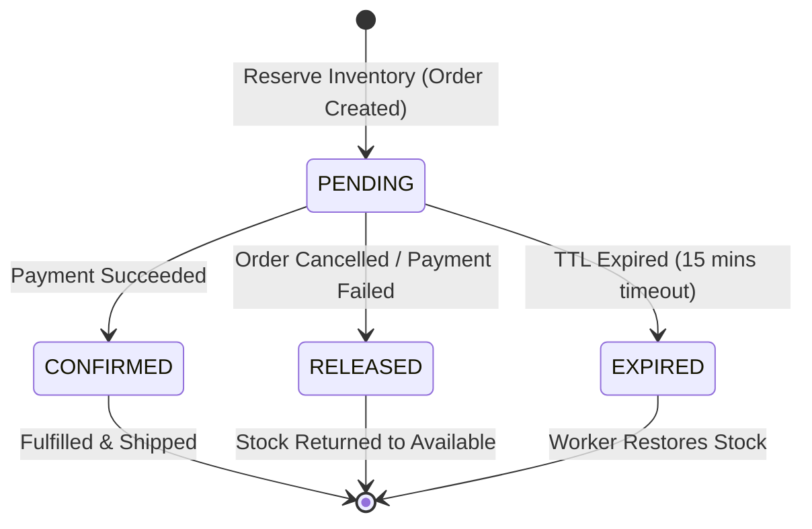

# Inventory Concurrency & Lifecycle Architecture

## 1. The Core Problem: Overselling & Concurrency
Trong các đợt mở bán hoặc sản phẩm có nhu cầu cao, hàng nghìn khách hàng có thể cùng gửi yêu cầu thanh toán cho cùng một SKU trong cùng một khoảnh khắc.

### Anti-Pattern nguy hiểm:
```csharp
// NGUY HIỂM: Dẫn đến Overselling khi có race conditions!
var inventory = await dbContext.Inventories.FirstOrDefaultAsync(x => x.SkuId == skuId);
if (inventory.AvailableQuantity >= requestedQty)
{
    inventory.AvailableQuantity -= requestedQty;
    await dbContext.SaveChangesAsync();
}
```
Nếu 2 request đồng thời đọc `AvailableQuantity = 1`, cả hai đều pass qua điều kiện `if`, sau đó cả hai cùng trừ 1, dẫn đến số lượng tồn kho bị sai lệch hoặc âm, bán thừa sản phẩm.

---

## 2. Production Solution: Atomic Conditional Update

Hệ thống xử lý bài toán này tại tầng Database Engine thông qua câu lệnh SQL Update có điều kiện nguyên tử:

```sql
UPDATE inventory.product_inventories
SET available_quantity = available_quantity - @requestedQty,
    reserved_quantity = reserved_quantity + @requestedQty,
    version = version + 1,
    updated_at = NOW()
WHERE sku_id = @skuId 
  AND available_quantity >= @requestedQty;
```

### Affected Rows Verification:
- **Nếu Affected Rows == 1:** Hệ thống đã trừ kho thành công và an toàn tuyệt đối nhờ Row-Level Lock tự nhiên của PostgreSQL. Bản ghi `inventory_reservations` được tạo với trạng thái `PENDING` và `expires_at = NOW() + 15 minutes`.
- **Nếu Affected Rows == 0:** Không có dòng nào thỏa mãn điều kiện `available_quantity >= @requestedQty`. Giao dịch lập tức bị hủy bỏ và ném ngoại lệ `OutOfStockException`.

---

## 3. Inventory Reservation State Machine



### Reservation States:
1. `PENDING`:
   - Hàng được giữ tạm cho đơn hàng trong 15 phút.
   - `available_quantity` giảm, `reserved_quantity` tăng.
2. `CONFIRMED`:
   - Khách thanh toán thành công.
   - `reserved_quantity` giảm tương ứng, hàng sẵn sàng xuất kho để giao vận.
3. `RELEASED` / `EXPIRED`:
   - Khách chủ động hủy đơn hoặc quá 15 phút mà không thanh toán.
   - Hoàn trả lại `available_quantity = available_quantity + @qty` và giảm `reserved_quantity = reserved_quantity - @qty`.

---

## 4. Multi-Item Checkout Deadlock Prevention

Khi một đơn hàng bao gồm nhiều mặt hàng (ví dụ: `SKU-C`, `SKU-A`, `SKU-B`):
Nếu Transaction 1 khóa `SKU-A` rồi chờ khóa `SKU-B`, trong khi Transaction 2 khóa `SKU-B` rồi chờ khóa `SKU-A`, PostgreSQL sẽ phát hiện **Deadlock** và chủ động abort một trong hai giao dịch.

### Biện pháp giải quyết:
Trước khi thực hiện vòng lặp trừ kho cho các items trong đơn hàng:
```csharp
// Sắp xếp danh sách SkuId tăng dần để đảm bảo thứ tự khóa tài nguyên luôn đồng nhất
var sortedItems = orderItems.OrderBy(x => x.SkuId).ToList();

foreach (var item in sortedItems)
{
    await ReserveStockAtomicAsync(item.SkuId, item.Quantity);
}
```
Nhờ quy tắc sắp xếp này, tất cả các transaction đều khóa `SKU-A` trước rồi mới khóa `SKU-B`, triệt tiêu hoàn toàn khả năng phát sinh deadlock giữa các transaction checkout đồng thời.

---

## 5. Background Reservation Expiry Worker

Một Background Worker chạy định kỳ mỗi 30 giây để quét và hoàn trả các reservation hết hạn:

```sql
-- 1. Khóa và lấy các reservation đã hết hạn
SELECT id, sku_id, quantity 
FROM inventory.inventory_reservations
WHERE status = 'PENDING' 
  AND expires_at < NOW()
LIMIT 100
FOR UPDATE SKIP LOCKED;

-- 2. Hoàn trả tồn kho nguyên tử
UPDATE inventory.product_inventories
SET available_quantity = available_quantity + @quantity,
    reserved_quantity = reserved_quantity - @quantity,
    updated_at = NOW()
WHERE sku_id = @skuId;

-- 3. Đánh dấu reservation thành EXPIRED
UPDATE inventory.inventory_reservations
SET status = 'EXPIRED',
    updated_at = NOW()
WHERE id = @reservationId;
```
Cơ chế `FOR UPDATE SKIP LOCKED` đảm bảo nếu hệ thống có 5 pod worker chạy đồng thời, các pod sẽ tự động phân chia các batch khác nhau mà không bao giờ bị xung đột khóa.
