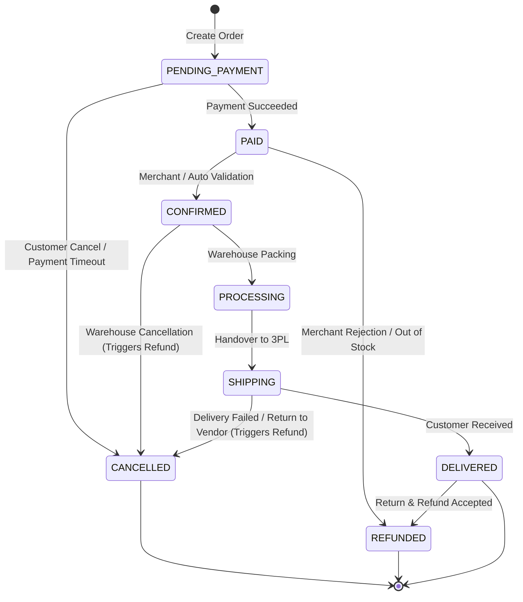
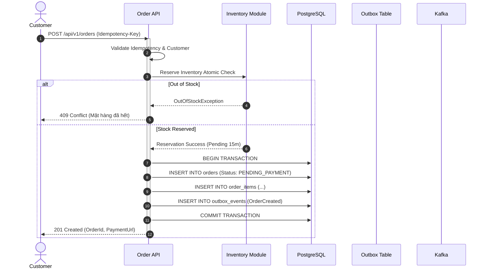

# Order Lifecycle & State Machine Architecture

## 1. Overview
Đơn hàng là trung tâm giao dịch của hệ thống E-Commerce. Để đảm bảo tính toàn vẹn và chống sai sót trạng thái (ví dụ: đơn chưa thanh toán mà nhảy sang đang giao hàng, hoặc đơn đã hủy lại được hoàn tiền hai lần), toàn bộ vòng đời của `Order` được quản lý bởi một **Deterministic State Machine**.

---

## 2. Order State Machine Diagram

---

## 3. Strict Transition Rules & Validation Matrix

Mỗi lần chuyển trạng thái bắt buộc phải thông qua phương thức domain của Aggregate Root `Order`. Tuyệt đối không cho phép gán trực tiếp thuộc tính `order.Status = ...`.

| Trạng thái hiện tại | Trạng thái kế tiếp hợp lệ | Hành động nghiệp vụ kích hoạt | Domain Event phát sinh |
| :--- | :--- | :--- | :--- |
| `PENDING_PAYMENT` | `PAID` | Nhận webhook thanh toán thành công | `OrderPaidDomainEvent` |
| `PENDING_PAYMENT` | `CANCELLED` | Khách hủy hoặc hết hạn thanh toán | `OrderCancelledDomainEvent` (Nhả tồn kho) |
| `PAID` | `CONFIRMED` | Đơn hàng được tự động/thủ công duyệt | `OrderConfirmedDomainEvent` |
| `PAID` | `REFUNDED` | Hủy đơn trước khi xử lý kho | `OrderRefundedDomainEvent` |
| `CONFIRMED` | `PROCESSING` | Kho bắt đầu in phiếu và đóng gói | `OrderProcessingStartedDomainEvent` |
| `PROCESSING` | `SHIPPING` | Đã bàn giao kiện hàng cho đối tác vận chuyển | `OrderShippedDomainEvent` |
| `SHIPPING` | `DELIVERED` | Đối tác vận chuyển báo giao hàng thành công | `OrderDeliveredDomainEvent` |
| `SHIPPING` | `CANCELLED` | Khách từ chối nhận hàng, hoàn về kho | `OrderReturnedDomainEvent` (Tạo refund) |
| `DELIVERED` | `REFUNDED` | Khiếu nại trả hàng/hoàn tiền được duyệt | `OrderRefundCompletedDomainEvent` |

Bất kỳ chuyển dịch trạng thái nào không nằm trong danh sách trên (ví dụ: `PENDING_PAYMENT` -> `DELIVERED`) đều sẽ ném ngoại lệ `InvalidOrderStateTransitionException` và dừng giao dịch ngay lập tức.

---

## 4. Order Creation Flow & Atomic Consistency

---

## 5. Compensation & Cancellation Handling
Khi đơn hàng bị hủy (`CANCELLED`):
1. **Nếu đơn chưa thanh toán:** Hệ thống bắn sự kiện `OrderCancelledDomainEvent`. Inventory Consumer tiêu thụ sự kiện và nhả `reserved_quantity` về `available_quantity`.
2. **Nếu đơn đã thanh toán:** Hệ thống kích hoạt lệnh Hoàn tiền (Refund Command) sang Payment Module thông qua saga/event-driven compensation. Chỉ khi Gateway xác nhận hoàn tiền thành công, trạng thái mới được chốt là `REFUNDED`.
