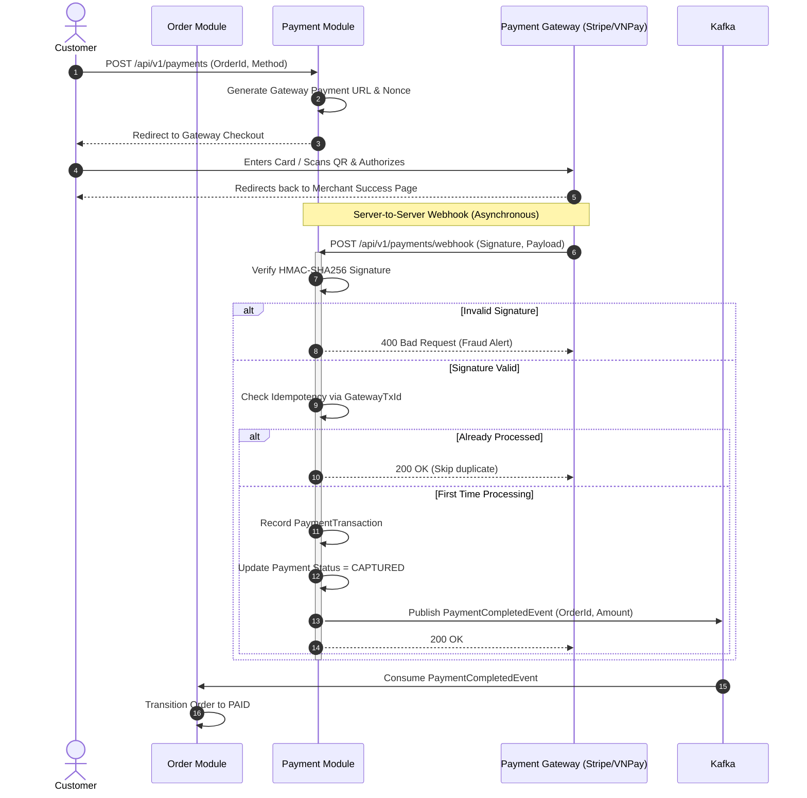

# Payment Architecture & Asynchronous Webhook Processing

## 1. Architectural Principles
1. **Never Trust the Client:** Tuyệt đối không cập nhật trạng thái thanh toán của đơn hàng dựa trên URL return hoặc phản hồi chuyển hướng từ browser của người dùng. Trạng thái chỉ được xác nhận chính thức qua **Server-to-Server Webhook** hoặc Polling API từ cổng thanh toán.
2. **Asynchronous by Default:** Tích hợp cổng thanh toán (VNPay, MoMo, Stripe, ZaloPay) luôn có độ trễ mạng và khả năng gián đoạn. Giao dịch luôn bắt đầu ở trạng thái `PENDING` và chờ webhook.
3. **Strict Webhook Idempotency:** Các cổng thanh toán thường gửi lại webhook nhiều lần (retries) nếu mạng chập chờn. Hệ thống phải đảm bảo xử lý lặp lại mà không ghi nhận doanh thu hai lần.
4. **Out-of-Order Webhook Protection:** Trong trường hợp webhook trạng thái `FAILED` đến sau webhook `SUCCESS`, hệ thống phải có logic kiểm tra phiên bản/trạng thái hiện tại để không ghi đè dữ liệu sai.

---

## 2. End-to-End Payment Flow



---

## 3. Webhook Security & Verification

### 3.1. Cryptographic HMAC Signature Check
Mọi webhook từ đối tác đều bắt buộc kèm chữ ký HMAC (ví dụ `X-Signature` header hoặc trường `vnp_SecureHash`):
```csharp
public bool VerifySignature(string rawPayload, string receivedSignature, string secretKey)
{
    using var hmac = new HMACSHA256(Encoding.UTF8.GetBytes(secretKey));
    var hashBytes = hmac.ComputeHash(Encoding.UTF8.GetBytes(rawPayload));
    var computedSignature = Convert.ToHexString(hashBytes).ToLowerInvariant();
    
    // So sánh thời gian cố định (Fixed-time comparison) để chống Timing Attacks
    return CryptographicOperations.FixedTimeEquals(
        Encoding.UTF8.GetBytes(computedSignature),
        Encoding.UTF8.GetBytes(receivedSignature.ToLowerInvariant())
    );
}
```

### 3.2. Idempotent Transaction Recording
Bảng `payment.payment_transactions` có ràng buộc:
```sql
CONSTRAINT uq_gateway_tx UNIQUE (gateway, transaction_code);
```
Khi webhook được gọi lại với cùng `transaction_code`:
1. Nếu lệnh INSERT ném lỗi vi phạm Unique Constraint, hệ thống hiểu đây là duplicate retry từ gateway.
2. Trả mã HTTP `200 OK` ngay lập tức để gateway dừng retry mà không xử lý lại nghiệp vụ.

---

## 4. Refund & Failure Handling
- **Payment Failed:** Khi khách hàng hủy thanh toán hoặc tài khoản không đủ tiền:
  - Cập nhật trạng thái Payment thành `FAILED`.
  - Xuất bản `PaymentFailedEvent` lên Kafka.
  - Order Module tiêu thụ sự kiện và chuyển đơn hàng sang `CANCELLED`.
  - Inventory Module tiêu thụ sự kiện và lập tức giải phóng số lượng hàng đang đặt trước (`reserved_quantity`).
- **Refund Policy:** Hoàn tiền hỗ trợ cả Full Refund và Partial Refund thông qua bảng `payment_transactions` loại `REFUND`, kiểm tra chặt chẽ `total_refunded <= original_charge_amount`.
